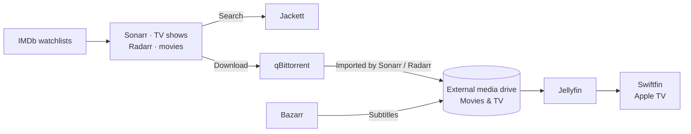
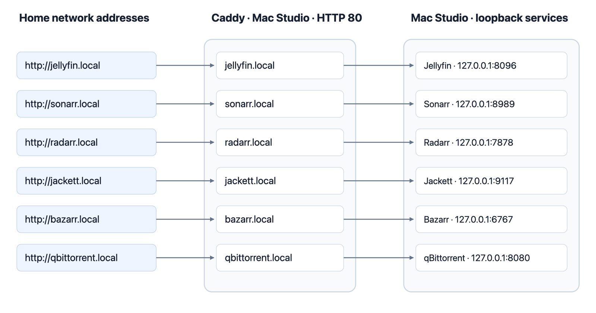

# Media server on Mac Studio

Native Apple Silicon media services controlled by one Python executable and one macOS system LaunchDaemon. Jellyfin, headless qBittorrent and the other native services run behind a disk-gated supervisor independent of graphical login.

This repository maintains an existing, host-specific installation. It is not a turnkey installer for arbitrary Macs. Application databases, credentials, media, installers and private migration evidence stay outside Git.

## Start here

- [Architecture](#architecture): content flow and local network routes.
- [Operate and update the Studio](docs/operations.md): start/stop, storage checks, backups, logs and recovery.
- [External storage recovery](docs/storage-recovery.md): bounded checks and recovery after a stalled volume.
- [Installation and rebuild prerequisites](docs/installation.md): native dependencies, boot service and deliberate installation steps.
- [Migrate restored configurations](docs/migration.md): offline database import, path conversion and stopped download queues.
- [Downloads appearing in Jellyfin](docs/imports.md): import notifications, movie identity and refresh checks.
- [English subtitles](docs/subtitles.md): automatic English downloads and Jellyfin playback defaults.
- [Verification and limits](docs/verification.md): automated checks, observed live behavior and outstanding tests.
- [IMDb watchlists](docs/imdb-watchlists.md): private movie lists and local TV bridge.
- [Compact HD movie policy](docs/movie-download-policy.md): optional profile configuration and rollback.
- [Apple TV playback](docs/apple-tv-playback.md): tested Swiftfin settings and their verification limits.
- [Controller](studio/media-server), [storage/startup tests](studio/test_storage_gate.py), [migration tests](studio/test_migration.py) and [runtime tests](studio/test_runtime.py).

## Architecture

The diagrams describe the existing installation, not its current health.

### Content flow

The server apps run on the Mac Studio; Swiftfin runs on Apple TV.



Sonarr and Radarr share the search and download connections shown above. Choose titles manually in either app, or configure personal IMDb lists: Radarr can use a native movie list, while TV lists use a local bridge to Sonarr. Personal list identifiers and API keys belong in private runtime configuration. FlareSolverr helps Jackett handle challenges only when an indexer requires it.

### Local network access



Bonjour / mDNS resolves the six names to the Mac Studio's LAN address; Caddy routes HTTP by hostname. Name resolution is separate from HTTP proxying. The five management hostnames are limited to the configured home subnet; Jellyfin retains its personal login. FlareSolverr uses internal port 8191 and has no published `.local` address.

## Services

| Tool | Role | Home-network address |
| --- | --- | --- |
| Jellyfin | Playback, library monitoring and VideoToolbox transcoding | `http://jellyfin.local` |
| Sonarr | TV catalog, searches and completed-download imports | `http://sonarr.local` |
| Radarr | Movie catalog, searches and completed-download imports | `http://radarr.local` |
| Jackett | Torznab indexers for Sonarr/Radarr | `http://jackett.local` |
| Bazarr | Subtitle synchronization and scheduled searches | `http://bazarr.local` |
| qBittorrent-nox | Native downloader with WebUI, no desktop interface | `http://qbittorrent.local` |
| FlareSolverr | Headless browser challenges for Jackett | Loopback only, port 8191 |

Caddy routes the six exact hostnames over HTTP port 80. Native Bonjour publishes their addresses on the LAN. Sonarr, Radarr, Jackett, Bazarr and qBittorrent open without a password from the configured home subnet. Caddy rejects other peer addresses, and these five apps listen only on Studio loopback. Jellyfin retains its personal account and watch history. No credentials are stored here. These addresses are intended for the home LAN.

Sonarr/Radarr use Jackett and qBittorrent; Bazarr connects to their APIs/event feeds. Jellyfin watches the shared media directories. All seven services, Caddy, publishers and the backup worker share the same storage gate.

## Important behavior

- Startup checks the external volume UUID, exact mountpoint, writable status, marker and media directories. A leftover folder or similarly named disk cannot substitute for the registered drive.
- Storage failure stops the owned stack. Restoring the correct volume permits automatic recovery. Intentional maintenance stays stopped until explicitly resumed.
- Acquisition is enabled for tested indexers and download clients. Original catalog records keep their monitoring choices; new monitored additions use the enabled pipeline. The owner removed the imported stopped torrents; verification preserves that decision.
- Settings backups run daily on the external disk; seven completed snapshots are retained. They are separate from independent/offsite backups.
- Normal boot does not download applications or updates. Native dependencies are installed deliberately through the controller.

## Folder map

```text
studio/          Maintained controller and automated tests
docs/            Installation, operation, diagrams, imports, subtitles and verification
scripts/         Diagram export maintenance
```

On the Studio, runtime is deliberately outside the checkout and iCloud:

```text
~/.local/share/media-server/
  media-server             Installed controller
  state/                   Private settings, databases and access credentials
  apps/                    Private dependencies and headless applications
  logs/ checks/            Runtime logs and verification receipts
  installers/ build/       Installation archives and build caches
  migration-backups/       Settings rollback snapshots
  media -> /Volumes/Media/media_server/data

~/Applications/            Native application bundles
/Volumes/Media/media_server/data/{movies,tv,downloads}/
/Volumes/Media/media-server-backups/
```

## Diagram maintenance

Edit the [local network SVG](docs/diagrams/local-network.svg), then run `./scripts/refresh-network-diagram.sh` on macOS to refresh its PNG.
